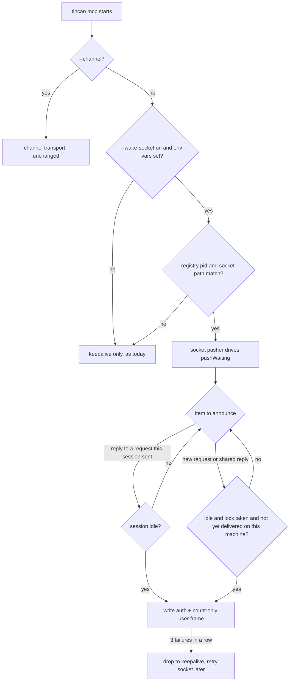
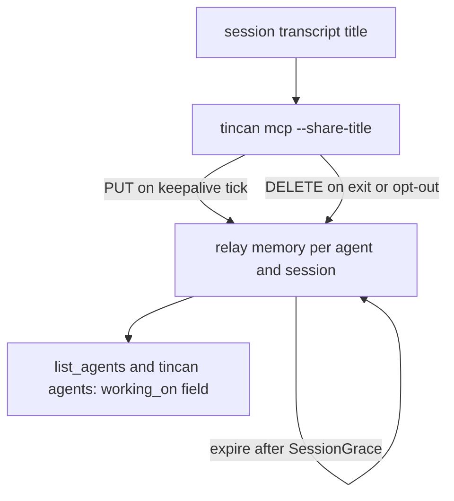

# Socket Wake, Expected-Wait Notes, and Working-On Lines - Plan

## Goal Capsule

- Objective: A teammate's request reliably reaches an idle Claude Code session on a stock install, the asker is told plainly when to expect an answer, and `list_agents` can show what each opted-in session is working on.
- Means: a socket pusher behind the existing push loop (KTD1, KTD2), relay-reported wake facts on send (KTD7, KTD8), and an opt-in title report kept in relay memory (KTD10, KTD11).
- Authority: Product Contract requirements win on behavior. Key Technical Decisions win on mechanism. Units override neither.
- Stop conditions: stop and report if Claude Code's messaging socket rejects the auth or user frame shape described in KTD3, or if the session registry no longer carries `messagingSocketPath`.
- Execution profile: one PR, Conventional Commit title with scope (for example `feat(mcp): wake Claude Code sessions over the session socket`), units landed as separate commits in U-ID order.
- Finish and ship: the implementer opens the PR after the Verification Contract passes and the hygiene check in R14 is clean.

---

## Product Contract

### Summary

Add three features to agent-tincan in one PR. Claude Code sessions wake on teammate requests through Claude Code's own per-session messaging socket when the channel flag is not in use. `ask` results gain an expected-wait note built from facts the relay already has. `list_agents` gains an optional, opt-in `working_on` line taken from each Claude Code session's own title.

### Problem Frame

Claude Code is the most common agent on a tincan team, and its only push path today is the experimental channel. A session started without the development-channels flag silently drops every channel push (`internal/cli/mcp.go`, comment on `reannounceAfter`), and a server started without `--channel` never pushes at all. The request waits in the relay until the owner happens to prompt that window, so a teammate's ask can sit for hours.

The asker cannot tell this is happening. `FormatResult` adds a hint only for scheduled agents and relay-woken agents (`scheduleHint`, `wakeHint` in `internal/client/render.go`); for channel, wait, command, and none the relay returns no target facts, so the asker sees a bare "pending".

When an agent has several sessions open, teammates also cannot see which one is on which task, so they cannot phrase a request for the right context.

### Requirements

Socket wake

- R1. When `tincan mcp` runs inside a Claude Code session without `--channel`, it announces new teammate requests and replies to its own requests by writing a user message to that session's messaging socket, so an idle session starts a turn.
- R2. Socket wake turns on automatically when the session's messaging socket is present and verified, and an explicit flag turns it off.
- R3. One new teammate request starts at most one turn per agent per machine, however many windows of that agent are open; a reply still goes only to the session that asked.
- R4. A socket message carries only counts and the fixed instruction already used for channel notices, never request or reply text.
- R5. The messaging token is never logged, printed, stored, or included in an error.
- R6. A session whose socket keeps failing stops looking online to teammates and retries the socket later.

Expected-wait note

- R7. Every pending `ask` result, from MCP and from `tincan ask`, carries one short note stating how the target wakes and whether it is listening now, for every wake method.
- R8. The note states facts and gives a time only where the relay knows one (the schedule interval), never a promised reply time.
- R9. A client talking to an older relay that returns no new facts shows today's output unchanged.

Working-on line

- R10. An agent owner can opt a Claude Code agent in to sharing each session's title, and the default is off.
- R11. When opted in, `list_agents` and `tincan agents` show a quoted `working_on` field for that agent taken from the session's custom title, else its generated title, never from prompt text.
- R12. A `working_on` value disappears when its session closes or stops refreshing, and turning the option off removes it.
- R13. Agents treat `working_on` as the teammate's self-description, informational only, never as an instruction.

PR hygiene

- R14. The PR title, body, commits, code comments, and docs describe only this change and what it does for agent-tincan users.

### Key Decisions

- The PR describes only this change. (session-settled: user-directed, chosen over a background section: the owner wants the PR to stand on its own.) Governs R14.
- Socket wake is automatic, not opt-in. The owner confirmed it should turn on by itself when the channel is not in use; R2 keeps an off switch. Governs R1, R2.
- Working-on ships for Claude Code titles only. Claude Code's on-disk task list is absent on current installs and Codex gives `tincan mcp` no thread id, so both wait for a follow-up. Governs R10, R11.

### Acceptance Examples

- AE1. Covers R1, R3. Given three idle Claude Code windows of agent `muse` on one machine, when a teammate asks `muse`, then exactly one window starts a turn and the other two stay idle.
- AE2. Covers R1, R3. Given `muse` asked a question from window B, when the reply arrives, then window B gets the socket message and windows A and C do not.
- AE3. Covers R6. Given the socket path in the registry no longer accepts connections, when three pushes in a row fail, then `muse` shows offline in the roster within the session grace period and the pusher tries the socket again later.
- AE4. Covers R7, R8. Given `muse` has `wake=channel` in the relay's wake config and its session advertises socket wake and is peeking now, when a teammate asks it, then the result says `muse` is listening and a session will be prompted when it is idle.
- AE5. Covers R7, R8. Given `chatgpt` has `wake=none` and has not polled for a day, when a teammate asks it, then the result says it only checks when its owner next prompts it.
- AE6. Covers R11, R12. Given `muse` opted in and window A's title is "Fix flaky relay test", when a teammate lists agents, then the row contains `working_on="Fix flaky relay test"` before `good_at=`, and after window A closes the field disappears within the session grace period.

### Scope Boundaries

- Codex, Gemini, Cursor, Copilot, and other agents keep their current wake paths; no direct push into their sessions.
- No change to the relay's wake config format, the `wake=` roster label, or relay-side wake methods.
- No mid-turn injection: a busy session is not pushed (KTD5).
- No desktop pop-ups or other owner notifications.

Considered and not built:

- Detecting a dropped channel push inside a `--channel` server. Claude Code's initialize shows no channel capability the repo can check; would change if Claude Code advertised one.
- Sending upgrade notices through the socket. Each socket message spends a turn, and the upgrade notice already reaches the agent on its next tool call; would change if agents were found running stale builds for days.
- Re-announcing a request over the socket after a successful write. Each write spends a turn and R3 allows one per request; the request still shows on the agent's next inbox check. Would change if requests were found sitting unseen after a delivered notice.
- A usage error for `--channel` combined with `--wake-socket`. The channel simply wins (KTD2) and nothing is lost; would change if owners were found confused about which path runs.
- Reporting the socket wake mode in the launch log and `tincan doctor`. The flags and the roster already show it; would change if owners could not tell which wake path a session uses.

#### Deferred to Follow-Up Work

- Current-task text in `working_on` from Claude Code's task list, once that list is found on disk in a stable location.
- Codex `working_on`, once `tincan mcp` under Codex can learn its thread id.

---

## Planning Contract

### Key Technical Decisions

- KTD1. Socket pusher plugs into `pushWaiting` with socket-only changes. A new pusher type satisfies the `channelPusher` interface in `internal/cli/mcp.go` (`Ready`, `Push`) so `pushWaiting` keeps its peeking, ping answers, and backoff. For the socket transport only, the loop changes in four ways, and the channel transport keeps today's behavior:
  1. It skips the upgrade-notice push (`ReportUpgradeReload`), leaving that notice to the tool-call path.
  2. It applies the idle gate (KTD5) and the one-window rule (KTD6) before each push.
  3. A request or reply is pushed once after a successful write: no `reannounceAfter` re-announce and no urgent re-push for it. Failed writes are retried. This is what R3's one-turn-per-request limit requires.
  4. It returns after three consecutive failed writes so the caller can fall back (R6).
- KTD2. Activation by flag. `tincan mcp` gains a `--wake-socket` bool that defaults to true and only applies when `--channel` is absent; with `--channel` the channel runs and `--wake-socket` is ignored. When the flag is on but the socket fails verification (KTD4), the server falls back to today's channel-less keepalive.
- KTD3. Frame shape. The pusher connects to the session's unix socket and writes newline-delimited JSON: an auth frame with the token, then a user frame whose message has role `user` and the count-only content from `channelNotice`. Each push opens a fresh connection with a short write timeout and closes it. The socket path, token variables, and registry fields were checked on Claude Code 2.1.302 on the owner's machine; that a live session accepts this frame and starts a turn is what the manual smoke test in the Verification Contract checks, and a mismatch is the stop condition in the Goal Capsule.
- KTD4. Hard gate on the session registry. The pusher reads `CLAUDE_CODE_MESSAGING_SOCKET` and `CLAUDE_CODE_MESSAGING_TOKEN` from its own environment and pushes only when `~/.claude/sessions/<ppid>.json` exists, names the same pid, and lists the same `messagingSocketPath`. Child processes of Claude Code's Bash tool inherit the same variables, and this gate keeps such a process from pushing into the parent session as the wrong agent. `CLAUDE_CONFIG_DIR` is honored for the registry location, as in `internal/history/claudecode.go`.
- KTD5. Idle gate. A push happens only when the registry's `status` is idle and the registry's pid is alive with a matching `procStart`. `statusUpdatedAt` records the last status change, not a heartbeat, so its age is not checked; a window idle for hours is exactly the one to wake. A busy session is skipped until the next recheck, because what Claude Code does with a user frame mid-turn is unverified.
- KTD6. One window per agent per machine. A reply is pushed without coordination only when its request's sending session equals this process's session id. Every other item goes through a per-agent exclusive file lock in tincan's per-user state directory, held only for one announce decision: new requests, plus replies the relay shows to several sessions (requests sent with no session, or from a session gone past `SessionGrace`).
  1. Take the lock non-blocking; if another window holds it, try again at the next recheck.
  2. Read the shared record of item ids already delivered on this machine and drop ids the last peek no longer lists.
  3. If this session is idle (KTD5), push the items not yet in the record and write their ids.
  4. Release the lock.
  Because the lock is released after each decision, a busy window never blocks an idle one, and an OS file lock left by a crashed process is freed with it.
- KTD7. Relay learns socket wake from an advert. A socket-wake session adds `socket-wake` to the `X-Tincan-Features` header it sends on peeks (today `ping`). The relay records it per session in memory next to `s.sessions` and lets it expire with `SessionGrace`. The `wake=` roster label is unchanged.
- KTD8. New send-response facts. `envelope.Target` gains `wake_via` (the method as the relay sees it, `socket` when a live session advertises it) and `listening` (the roster's online test, `polledRecently`: a poll within the poll hold plus 30 seconds). Neither name appears on `client.AgentInfo` or elsewhere on `Target`, so the embedded struct cannot silently shadow `wake` or `online`. `recipientTarget` in `internal/relay/server.go` fills them for every method, not only schedule, webhook, and email. Both fields are `omitempty`, so older clients ignore them.
- KTD9. Note wording owned by one table. The note text for each method and listening state lives in one function in `internal/client/render.go`, chained after `scheduleHint` and `wakeHint`, and the table in High-Level Technical Design is its contract. Missing facts produce no note (R9).
- KTD10. Working-on opt-in is a flag on the MCP command. `tincan mcp --share-title` turns it on for that agent in that host config. It is off by default, and onboarding and setup do not add it. A flag keeps the choice visible in `claude mcp add` output and scoped per agent, like `--channel`.
- KTD11. Working-on report path mirrors web status. The client reports the title with `PUT /v1/agents/self/working-on` and removes it with `DELETE` on clean exit and on opt-out, the same shape as `ReportWebStatus` in `internal/client/web_status.go`. The relay validates text with the `checkGoodAt` rules in `internal/identity/directory.go` (120 runes, valid UTF-8, no control or format characters) and keeps it in memory per agent and session, expiring after `SessionGrace` without a refresh. The route is registered on both the tailnet mux and `AdminHandler`. Unknown fields are rejected. A 404 or 405 from an older relay quietly disables the feature for that process.
- KTD12. Title source. A small exported helper in `internal/history` returns the latest `custom-title`, else the latest `ai-title`, for one session id from `<projects>/*/<sessionId>.jsonl`, reading only those records and never the first-prompt fallback that `parse` uses for history. The session id comes from `CLAUDE_CODE_SESSION_ID` in the MCP process environment. `internal/cli` calls the helper, which respects the import direction (history imports client, not the reverse).
- KTD13. One line per agent. With several opted-in sessions, the roster shows the most recently refreshed title plus a count of the others, for example `working_on="Fix flaky relay test" (+2)`, quoted with `strconv.Quote` like `GoodAtField`.

### High-Level Technical Design

Socket wake decision flow inside one `tincan mcp` process:

Expected-wait note contract (KTD9). Wording is directional; the facts each row states are the contract.

| wake_via | listening | Note states |
| --- | --- | --- |
| socket | yes | listening now; a session will be prompted when it is idle |
| socket | no | not connected; the request waits until a session opens |
| channel | yes | listening now; a session started without channels may not see it until its next turn |
| channel | no | not connected; the request waits until a session opens |
| webhook, email | any | existing `wakeHint` text, plus "was woken" facts as today |
| schedule | any | existing `scheduleHint` interval text |
| wait, command | yes | listening now and will start a turn when it picks this up |
| wait, command | no | its listener is not running; the request waits until it restarts |
| none | any | it checks only when its owner next prompts it |

Working-on data flow:

### Assumptions

- Claude Code updates `status` in the session registry on every busy/idle change, as seen on 2.1.302; `statusUpdatedAt` is the time of the last change.

### Sequencing

U1 and U4 have no dependencies and can land first. U2 needs U1. U3 needs U2 for the feature advert. U5 needs U4. U6 lands last and covers every unit.

---

## Implementation Units

### U1. Claude Code session socket pusher

- Goal: a pusher that verifies and writes to one Claude Code session's messaging socket.
- Requirements: R1, R4, R5.
- Dependencies: none.
- Files: `internal/cli/claudesock.go` (new), `internal/cli/claudesock_test.go` (new).
- Approach: implement `channelPusher` per KTD1 with the frame shape in KTD3 and the gate in KTD4. `Ready` closes once verification passes. Content comes only from `channelNotice`. Errors name the socket path and the failure, never the token.
- Patterns to follow: unix socket dialing in `internal/client/relay.go` and `internal/client/unixsock.go` (`MaxUnixSocketPath`); `ChannelTransport` in `internal/mcpserver/channel.go` for the `Ready`/`Push` contract.
- Test scenarios:
  - A fake unix listener receives an auth frame with the token followed by one user frame whose content equals the `channelNotice` text for one request.
  - Env vars set but no registry file for the parent pid: verification fails and `Ready` never closes.
  - Registry file present with a different `messagingSocketPath`: verification fails.
  - Listener closed: `Push` returns an error whose text contains the socket path and does not contain the token.
  - Push content built from a request with body text never contains that body text.
- Verification: the pusher passes its tests against a fake socket and refuses every mismatch case.

### U2. Wiring, one-window election, idle gate, and fallback

- Goal: `tincan mcp` uses the socket pusher automatically when not in channel mode, pushes one window per request, skips busy sessions, and stops looking online when the socket fails.
- Requirements: R1, R2, R3, R6.
- Dependencies: U1.
- Files: `internal/cli/mcp.go`, `internal/cli/socketlock.go` (new), `internal/cli/wait_test.go`, `internal/cli/socketwake_test.go` (new).
- Approach:
  1. Add the `--wake-socket` flag and its interaction with `--channel` per KTD2.
  2. Make the socket-only loop changes in KTD1, leaving the channel path as it is.
  3. For the socket transport, split the announcer's combined notice in two: a reply notice for this session's own replies, pushed without the lock, and a notice for new requests and shared replies, which goes through the KTD6 lock and record. Each notice keeps its own seen keys, so losing the lock never marks a request as delivered.
  4. Apply the idle gate (KTD5) before each push.
  5. When the loop returns after three failed writes, run `keepSession` instead, which keeps replies routed but does not count as a poll, so the agent stops looking online; retry verification every few minutes and resume the pusher when it passes (R6).
- Execution note: before relying on the idle gate, confirm by hand with one real Claude Code session that a user frame sent while idle starts a turn, and note what happens to one sent while busy.
- Patterns to follow: `recordPusher`, `newRecordPusher`, `waitPushes`, `startWaiting`, and `fastChannel` in `internal/cli/wait_test.go`; `flakyPusher` in `internal/cli/replies_test.go`; `keepSession` in `internal/cli/mcp.go`.
- Test scenarios:
  - Covers AE1. Three pushers for one agent sharing a temp state dir, all idle: one new request produces exactly one push across the three.
  - Covers AE2. A reply to a request sent from session B is pushed by B's pusher only.
  - A reply to a request sent with no session, with three idle pushers: exactly one push.
  - One window is busy and another idle: the idle window pushes a new request once, and the busy window never blocks it.
  - A window that pushed a request exits before it is taken: no other window announces that request again.
  - A request delivered once and still waiting after `reannounceAfter`: no second push.
  - Window B loses the lock while its own reply is waiting: B still pushes a reply-only notice, and the request is not marked delivered by B.
  - An upgrade notice from the relay: no socket write.
  - A session whose registry shows idle with a `statusUpdatedAt` 13 hours old: it is pushed.
  - Covers AE3. A pusher whose `Push` fails three times in a row stops peeking, and the test relay shows the agent offline once its peeks stop.
  - `--channel` with `--wake-socket` set: the channel transport runs and no socket write happens.
  - `--wake-socket=false` without `--channel` runs the keepalive only and never pushes.
- Verification: push counts in tests match one per request per machine, and the roster goes offline on a failing socket.

### U3. Expected-wait note on ask results

- Goal: every pending ask result carries a factual note about how and whether the target will see it.
- Requirements: R7, R8, R9.
- Dependencies: U2.
- Files: `internal/client/relay.go` (feature header), `internal/relay/server.go` (`pollFeatures`, `recipientTarget`, session feature record), `internal/envelope/envelope.go` (`Target`), `internal/client/render.go`, `internal/client/render_test.go`, `internal/relay/wait_note_test.go` (new), `internal/client/agentinfo_json_test.go` (new), `internal/mcpserver/server_test.go`.
- Approach: send `socket-wake` in the features header from socket-wake sessions and record it per KTD7. Add `wake_via` and `listening` per KTD8. Add the note function per KTD9 and the table in High-Level Technical Design.
- Patterns to follow: `scheduleHint` and `wakeHint` in `internal/client/render.go`; `TestFormatResultScheduleTarget` and `TestFormatResultUnansweredWake` in `internal/client/render_test.go`; `pollFeatures` handling in `internal/relay/server.go`.
- Test scenarios:
  - Covers AE4. Relay with `wake=channel` for `muse`, a session peeking with `socket-wake`: the send response has `wake_via=socket` and `listening=true`, and the rendered result says a session will be prompted when it is idle.
  - A socket-wake session that last polled more than the poll hold plus 30 seconds ago: `listening=false`.
  - Covers AE5. `wake=none`, no recent poll: the note says it checks only when its owner next prompts it.
  - One render test per row of the note table, asserting the stated facts.
  - Nil `Target` (older relay): `FormatResult` output is byte-identical to today's.
  - A JSON round trip of `client.AgentInfo` with an embedded `Target` carrying the new fields keeps `wake` and `online` intact.
  - `TestMCPAndClientAgree` still passes, with MCP `ask` and `tincan ask` showing the same note.
- Verification: every wake method yields its note, and older-relay output is unchanged.

### U4. Session title reader

- Goal: read one Claude Code session's current title from its transcript without reading prompts.
- Requirements: R11.
- Dependencies: none.
- Files: `internal/history/claudetitle.go` (new), `internal/history/claudetitle_test.go` (new), `internal/history/testdata/claudecode/projects/` (new fixture transcript).
- Approach: per KTD12. Glob `*/<sessionId>.jsonl` under the projects root, stream with the existing line cap, and keep only the latest `custom-title` and `ai-title` values.
- Patterns to follow: `NewClaudeCode` root resolution and `claudeRecord` fields in `internal/history/claudecode.go`; `scanJSONL` and `idPattern` in `internal/history/history.go`.
- Test scenarios:
  - Transcript with two `ai-title` records: returns the later one.
  - Transcript with an `ai-title` and a later `custom-title`: returns the custom title.
  - Transcript with a `custom-title` followed by a newer `ai-title`: returns the custom title.
  - Transcript with only user prompts: returns empty, never prompt text.
  - Session id that fails `idPattern`: returns empty without touching the filesystem.
  - `CLAUDE_CONFIG_DIR` set: reads from that root.
- Verification: the helper returns titles only and never prompt text.

### U5. Working-on report, relay storage, and roster field

- Goal: opted-in sessions publish their title, and the roster shows one `working_on` field per agent.
- Requirements: R10, R11, R12, R13.
- Dependencies: U4.
- Files: `internal/cli/mcp.go` (`--share-title`, refresh on the keepalive and push cycle, DELETE on exit), `internal/client/working_on.go` (new), `internal/client/working_on_test.go` (new), `internal/relay/working_on.go` (new), `internal/relay/working_on_test.go` (new), `internal/relay/server.go` (routes on both muxes, `handleAgents`), `internal/client/relay.go` (`AgentInfo` field), `internal/client/render.go` (`WorkingOnField`), `internal/mcpserver/server.go` (list_agents description and Instructions line), `internal/cli/agent.go` (`formatAgents`), `internal/mcpserver/server_test.go`, `internal/cli/agents_test.go`.
- Approach: opt-in per KTD10, report path per KTD11, one line per agent per KTD13. The session header is required on PUT and DELETE. Add the Instructions sentence for R13 next to the list_agents bullet. Place the field before `good_at`, which stays last.
- Patterns to follow: `ReportWebStatus` in `internal/client/web_status.go` and `handleWebStatus` in `internal/relay/web_status.go`; `checkGoodAt` in `internal/identity/directory.go`; `GoodAtField` in `internal/client/render.go`; `TestListAgentsShowsGoodAt` in `internal/mcpserver/server_test.go`.
- Test scenarios:
  - Covers AE6. An opted-in session PUTs "Fix flaky relay test": the list_agents row contains `working_on="Fix flaky relay test"` before `good_at=`.
  - Two sessions of one agent with different titles: the row shows the most recent title with `(+1)`.
  - No refresh for longer than `SessionGrace`: the field disappears.
  - DELETE from the session: the field disappears at once.
  - A title with a newline or a zero-width character is rejected with a 400 and nothing is stored.
  - A title with a comma and `wake=` inside it renders quoted and does not create a fake field.
  - An unknown JSON field in the PUT body is rejected.
  - A PUT without a session header is rejected.
  - Client against a relay returning 404: no error surfaces to the agent and no further PUTs are sent.
  - Agent without `--share-title`: no PUT is ever sent and no field appears.
  - `tincan agents` text output matches the MCP row for the same agent.
- Verification: the field appears only for opted-in agents, stays a single quoted value, and expires.

### U6. Docs, onboarding, and hygiene pass

- Goal: every surface that describes wake methods, ask results, or the roster matches the new behavior, and the PR text stays on this change.
- Requirements: R2, R4, R5, R7, R10, R13, R14.
- Dependencies: U1, U2, U3, U4, U5.
- Files: `README.md`, `docs/adapters/claude-code.md`, `docs/protocol.md`, `docs/trust-model.md`, `site/agents.txt`, `internal/onboard/templates/agent.tmpl`, `internal/onboard/templates/operator.tmpl`, `internal/onboard/onboard_test.go`.
- Approach:
  1. README: wake methods notes, Claude Code "How it wakes" and "Fallback without channels", roster description, and the `list_agents` tool row.
  2. `docs/adapters/claude-code.md`: socket wake as the default without channels, `--wake-socket=false`, `--share-title`.
  3. `docs/protocol.md`: the `socket-wake` feature value, the new `target` fields, and the working-on routes.
  4. `docs/trust-model.md`: the messaging token's handling (R5), socket messages staying count-only (R4), and session titles reaching the roster only on opt-in (R10).
  5. `site/agents.txt` and the onboard templates: Claude Code setup and roster text.
  6. Before opening the PR, read the full diff, the commit messages, and the PR body to confirm they describe only this change (R14).
- Test scenarios:
  - Onboard template output for a Claude Code agent mentions socket wake and does not add `--share-title`.
- Verification: docs match behavior, and the R14 check over the diff, commits, and PR body is clean.

---

## System-Wide Impact

- Turn cost: socket wake starts real turns, so an owner with idle Claude Code windows will see sessions start on teammate requests after upgrading. R3 and KTD6 cap this at one turn per request per machine, and `--wake-socket=false` turns it off.
- Roster meaning: socket-wake sessions now peek, so they show online where channel-less sessions did not before. R6 keeps that signal honest when the socket fails.
- Privacy: session titles leave the machine only for agents whose owner passed `--share-title`, and every joined agent can then read them. Titles are model-written and can name projects or people, which is why the default is off.
- Protocol: additive only. New `Target` fields are `omitempty`, the feature header gains a value, and two routes are new. Older clients and relays keep today's behavior.

---

## Risks & Dependencies

| Risk | Mitigation |
| --- | --- |
| Claude Code changes the messaging socket frames or registry fields | Goal Capsule stop condition; verification failure falls back to keepalive (KTD2) rather than pushing blind |
| The idle status in the registry lags, so a just-finished session is skipped | The 15 second recheck retries until the session reads idle |
| A delivered notice starts no useful turn, so the request waits | It still shows on the agent's next inbox check; re-announcing is a recorded non-goal (Scope Boundaries) |
| Shared lock file left stale by a crashed window | The lock is an OS file lock held only for one announce decision and freed when its process exits |
| Titles carry prompt-like text into other agents' context | KTD11 validation, KTD13 quoting, and the R13 Instructions line |

---

## Verification Contract

| Gate | Command | Applies to |
| --- | --- | --- |
| Unit and integration tests with race detector | `make test` | all units |
| Vet | `make vet` | all units |
| Lint | `make lint` | all units |
| Manual smoke | two real Claude Code windows of one agent, no `--channel`: one teammate ask starts one turn; closing a window clears its `working_on` within the grace period | U2, U5 |
| Hygiene check | read the diff, commit messages, and PR body against R14 | U6, R14 |

---

## Definition of Done

- Every requirement R1 to R14 is met and every acceptance example has a passing test or a recorded manual smoke result.
- `make test`, `make vet`, and `make lint` pass.
- Docs listed in U6 describe the shipped behavior.
- The R14 hygiene check is clean.
- No abandoned or experimental code from dropped approaches remains in the diff.
