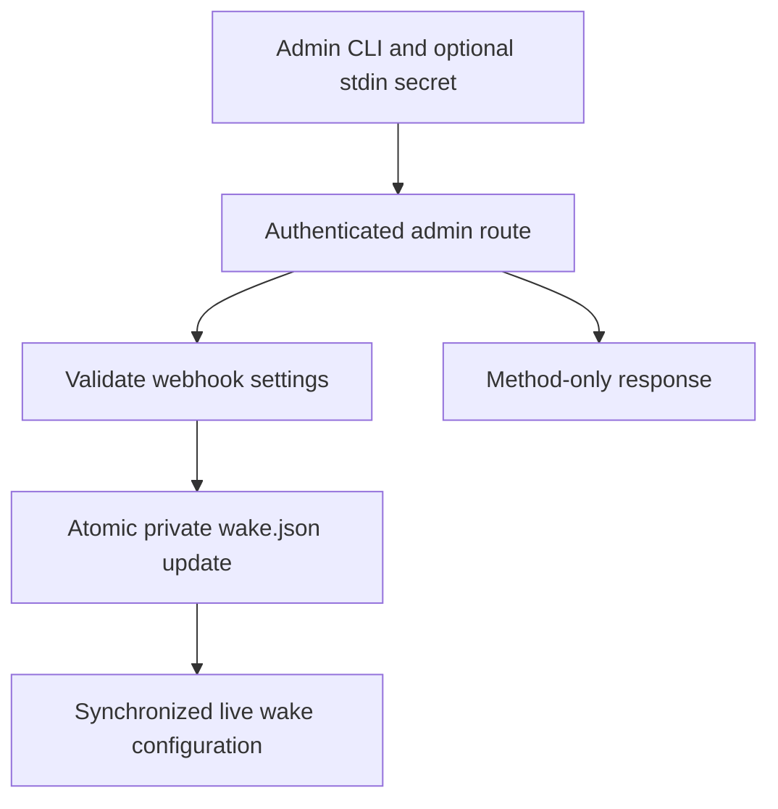

# Fix setup friction and refresh release documentation

## Goal Capsule

Make the setup reported in issue #168 work without hand editing service definitions or wake secrets, and make the README and website describe the current release. The owner authorizes implementation, verification, documentation, website updates and an open PR.

## Product Contract

### Summary

Resolve all eight reported setup problems and refresh public instructions through v0.18.1.

### Problem Frame

A successful four-agent setup needed undocumented extension installation, service edits, relay secret edits and deferred-tool discovery. Older website copy hides capabilities already released.

### Requirements

| ID | Outcome | Source |
| --- | --- | --- |
| R1 | Document unpacked extension installation and fixed ID; checksum the release zip. | #168.1 |
| R2 | Install a web agent under its invited name and explicit config without editing a service. | #168.2 |
| R3 | Explain platform defaults and retain the exact config selected at join. | #168.3 |
| R4 | Configure webhook wakes through an admin CLI with stdin secrets, private atomic persistence and immediate application. | #168.4 |
| R5 | Give Claude Code exact deferred-tool selectors and identify MCP and CLI reply surfaces. | #168.5 |
| R6 | Show the actual reply status and rejection reasons; preserve loop protection and successful replies. | #168.6 |
| R7 | Explain supervisor restrictions and Hermes noninteractive MCP setup. | #168.7 |
| R8 | Mark messages typed into web chats with relay request identity. | #168.8 |
| R9 | Refresh README, website and machine-readable summaries for current releases and upgrade requirements. | Owner request |

### Scope Boundaries

Chrome Web Store publication is outside this change; the release zip provides the documented fallback. A failed reply remains failed even though the audit event says replied. Existing approval and loop protections remain applicable.

## Planning Contract

### Key Technical Decisions

- KTD1. Extend service generation with a validated agent name and absolute config path. Keep default service names compatible; custom names get distinct definitions.
- KTD2. Admin-only webhook configuration is persisted on the relay, retaining unrelated entries and existing options. All live reads use a synchronized config snapshot; no credentials are returned by list or errors.
- KTD3. Format web provenance after parsing threading directives, before size checks and submission, so continuation and pass behavior still work.
- KTD4. Use stored request and reply outcomes as authoritative. Improve trace diagnostics rather than reinterpret failed replies as success.

### High-Level Technical Design

Directional flow for webhook configuration:

### Sequencing and Risks

Implement service naming, prompts and diagnostics first, then wake configuration and documentation. Regression coverage must exercise permission checks, secret redaction, concurrent wake reads, preservation of existing targets, and failed writes. Website publication uses the existing Vercel site configuration; verify the deployment route before claiming the live domain changed.

## Implementation Units

### U1. Service identity and onboarding (R2, R3, R7)

Files: `internal/cli/web.go`, `internal/history/service.go`, `internal/history/service_test.go`, `internal/onboard/templates/agent.tmpl`, `site/agents.txt`, `docs/adapters/web-agents.md`, `docs/adapters/hermes.md`.

Test custom names on macOS and Linux, explicit configs with spaces, invalid names, default compatibility, and generated onboarding instructions. Explain platform defaults without moving existing credentials.

### U2. Extension packaging and installation (R1)

Files: `Makefile`, `extension/README.md`, `README.md`, `site/agents.txt`, `docs/adapters/history.md`, `docs/adapters/web-agents.md`.

Verify an isolated checksum fixture includes the extension zip and binaries. Document release zip verification, Developer mode, Load unpacked and the expected extension ID.

### U3. Agent prompts and trace diagnostics (R5, R6, R8)

Files: `internal/cli/mcp.go`, `internal/client/render.go`, `internal/cli/trace.go`, `internal/history/web.go`; tests in their owning packages.

Test exact selectors in channel notices, both reply surfaces in claim guidance, provenance in actual send payloads, preserved continuation directives and size limits. Test an answered parent followed by rejected loop attempts; verify its status remains answered. Show failed reply status and rejection reasons explicitly.

### U4. Webhook management (R4)

Files: new wake configuration files and tests under `internal/wake`, new admin handler and tests under `internal/relay`, new command and tests under `internal/cli`, plus relay wiring.

Test admin authorization, malformed input, invalid URLs, stdin token handling, redacted list, 0600 atomic writes, unrelated configuration preservation, persistence failures, and runtime changes under race detection. Do not expose wake URLs or credentials to joined agents.

### U5. Current product documentation (R9)

Files: `README.md`, `site/index.html`, `site/agents.txt`, `site/llms.txt`, relevant adapter docs.

Cover live team status/watch, failover boundaries, pass approval, phone access/push, rooms, coding teammates, prior additions still missing from public copy, extension 0.6.5 and relay-first upgrades. Verify commands against current help and releases, render the site at desktop and phone widths, and verify deployment identity before publication.

## Verification Contract

Run targeted Go tests during implementation, then `go test -race ./...`, `go vet ./...`, static Go build, and `make extension-test`. Verify checksum generation with isolated assets. Check the website in a browser and inspect public deployment output if published.

## Definition of Done

All requirements have implementation or accurate operational instructions, automated checks pass, README and site describe current capabilities, a reviewed PR links #168, and the final report distinguishes committed website changes from live publication.

## Sources

- https://github.com/mvanhorn/agent-tincan/issues/168
- https://github.com/mvanhorn/agent-tincan/releases/tag/v0.18.0
- https://github.com/mvanhorn/agent-tincan/releases/tag/v0.18.1
